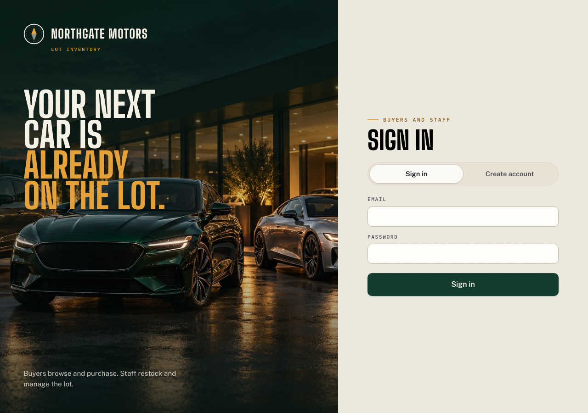
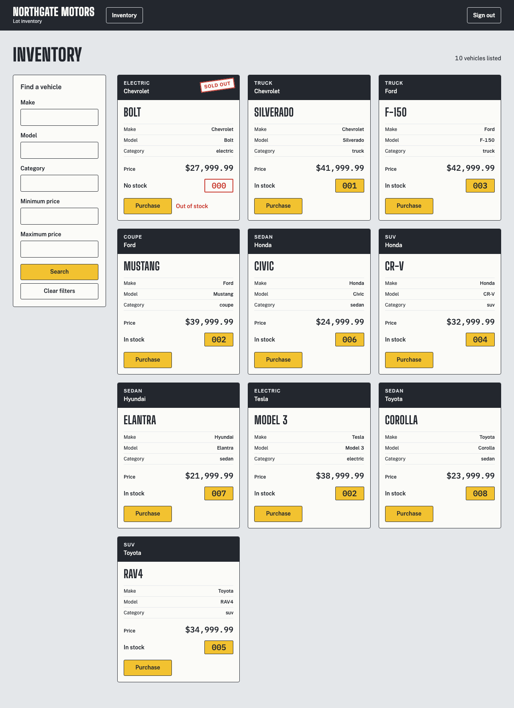
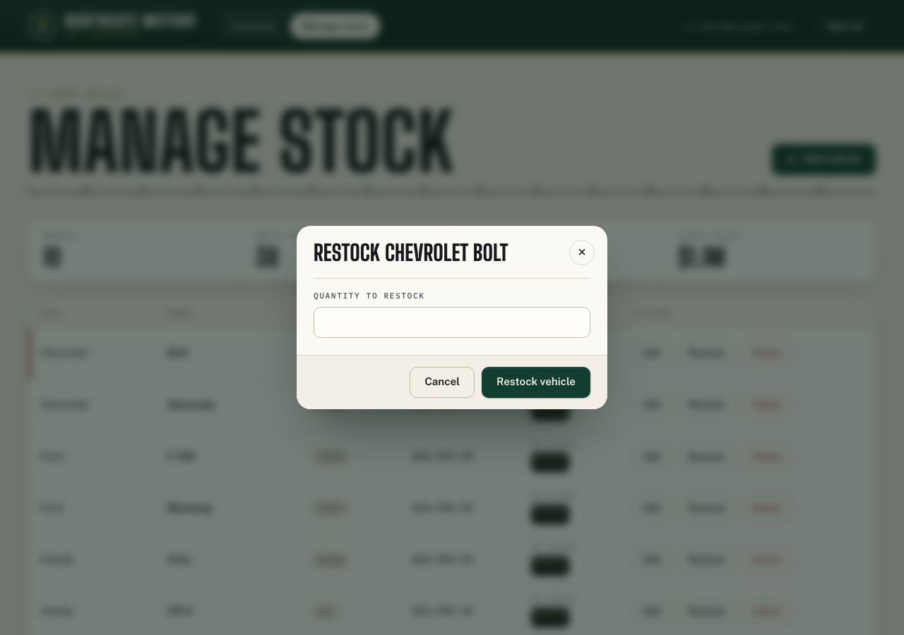
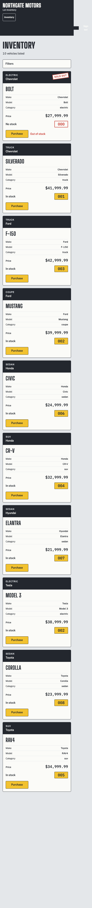

# Northgate Motors

Northgate Motors is a car dealership inventory system with account registration and login, vehicle inventory search, one-unit purchases, and administrator tools to add, edit, restock, and delete vehicles. The production demo is at [car-dealership-inventory-phi.vercel.app](https://car-dealership-inventory-phi.vercel.app).

## Screenshots

- Authentication, desktop: 
- Inventory, desktop: 
- Administration with the restock dialog: 
- Inventory, mobile: 

## Stack

- Frontend: React, TypeScript, Vite, and Tailwind CSS
- Backend: Node.js, TypeScript, and Express
- Database: PostgreSQL; Docker locally and in CI, Supabase for preview and production
- Authentication: JWT and bcrypt
- Validation: Zod
- Tests: Vitest, Supertest, React Testing Library, and Playwright Test
- Hosting and CI: Vercel and GitHub Actions

## Local setup

Requirements: Node.js 22.9 or newer and Docker with Docker Compose. From a fresh clone:

```sh
git clone https://github.com/SNiPERxDD/car-dealership-inventory.git
cd car-dealership-inventory
npm ci
cp .env.example .env
```

Set `ADMIN_EMAIL` and `ADMIN_PASSWORD` in `.env` to local development values, then start PostgreSQL, apply migrations, seed the local administrator and demo inventory, and run the app:

```sh
npm run db:up
npm run db:migrate
npm run db:seed
npm run dev
```

The API runs at `http://localhost:3001`; Vite serves the web app at `http://localhost:5173` and proxies `/api` to the API. Run the project checks with:

```sh
npm test
npx playwright install chromium webkit
npx playwright test
npm run typecheck
npm run lint
npm run build
```

## API reference

Protected routes require `Authorization: Bearer <token>`. `user` means any authenticated account; `admin` means an authenticated administrator. Errors use `{ "error": { "code", "message" } }`.

| Method   | Path                         | Auth  | Success | Error codes                                                                                                                                                                         |
| -------- | ---------------------------- | ----- | ------- | ----------------------------------------------------------------------------------------------------------------------------------------------------------------------------------- |
| `GET`    | `/api/health`                | none  | `200`   | `DATABASE_UNAVAILABLE` (`503`), `INTERNAL_ERROR` (`500`)                                                                                                                            |
| `POST`   | `/api/auth/register`         | none  | `201`   | `VALIDATION_ERROR` (`400`), `INVALID_JSON` (`400`), `EMAIL_TAKEN` (`409`), `INTERNAL_ERROR` (`500`)                                                                                 |
| `POST`   | `/api/auth/login`            | none  | `200`   | `VALIDATION_ERROR` (`400`), `INVALID_JSON` (`400`), `INVALID_CREDENTIALS` (`401`), `INTERNAL_ERROR` (`500`)                                                                         |
| `POST`   | `/api/vehicles`              | admin | `201`   | `UNAUTHENTICATED` / `INVALID_TOKEN` (`401`), `FORBIDDEN` (`403`), `VALIDATION_ERROR` / `INVALID_JSON` (`400`), `INTERNAL_ERROR` (`500`)                                             |
| `GET`    | `/api/vehicles`              | user  | `200`   | `UNAUTHENTICATED` / `INVALID_TOKEN` (`401`), `INTERNAL_ERROR` (`500`)                                                                                                               |
| `GET`    | `/api/vehicles/search`       | user  | `200`   | `UNAUTHENTICATED` / `INVALID_TOKEN` (`401`), `VALIDATION_ERROR` (`400`), `INTERNAL_ERROR` (`500`)                                                                                   |
| `POST`   | `/api/vehicles/:id/purchase` | user  | `200`   | `UNAUTHENTICATED` / `INVALID_TOKEN` (`401`), `VALIDATION_ERROR` (`400`), `VEHICLE_NOT_FOUND` (`404`), `OUT_OF_STOCK` (`409`), `INTERNAL_ERROR` (`500`)                              |
| `POST`   | `/api/vehicles/:id/restock`  | admin | `200`   | `UNAUTHENTICATED` / `INVALID_TOKEN` (`401`), `FORBIDDEN` (`403`), `VALIDATION_ERROR` (`400`), `VEHICLE_NOT_FOUND` (`404`), `STOCK_LIMIT_EXCEEDED` (`409`), `INTERNAL_ERROR` (`500`) |
| `PUT`    | `/api/vehicles/:id`          | admin | `200`   | `UNAUTHENTICATED` / `INVALID_TOKEN` (`401`), `FORBIDDEN` (`403`), `VALIDATION_ERROR` (`400`), `VEHICLE_NOT_FOUND` (`404`), `INTERNAL_ERROR` (`500`)                                 |
| `DELETE` | `/api/vehicles/:id`          | admin | `204`   | `UNAUTHENTICATED` / `INVALID_TOKEN` (`401`), `FORBIDDEN` (`403`), `VALIDATION_ERROR` (`400`), `VEHICLE_NOT_FOUND` (`404`), `INTERNAL_ERROR` (`500`)                                 |

Malformed JSON returns `INVALID_JSON` (`400`); an unknown route returns `NOT_FOUND` (`404`).

## Architecture

Express routes handle HTTP and authorization, services apply inventory rules, and repositories own parameterized PostgreSQL queries. Purchases and restocks each use one conditional `UPDATE ... RETURNING` statement, so concurrent requests cannot oversell or exceed the stock limit. Migrations enable row-level security (RLS) on Supabase tables without client policies; the API connects as the table owner, while the Supabase Data API roles remain denied.

## Testing

The project has unit tests for validation and service rules, PostgreSQL integration and database tests through Supertest, React component tests, and Playwright end-to-end tests. A 20-request concurrent purchase test starts with one unit and verifies exactly one success, nineteen out-of-stock responses, and zero remaining stock. See the [test report](docs/test-report.md).

## Demo accounts

| Role  | Email                       | Password             |
| ----- | --------------------------- | -------------------- |
| admin | `admin@northgate-demo.test` | `Admin-f1f1740f26f0` |
| user  | `user@northgate-demo.test`  | `User-af035bd25c01`  |

Demo data only; credentials are for review.

## Git history

RED commits (`test: ... (red)`) record failing behavioral tests as intermediate history; every pushed tip is green.

## My AI Usage

### Tools and how I used them

- ChatGPT helped plan the phases, architecture, requirement mapping, and test strategy.
- Claude Code with Claude Opus 5.5 led planning, per-slice briefs, review judgment, and commits.
- Codex with GPT-6 Luna handled implementation and verification in delegated lanes.
- OpenCode and Kilo provided independent reviews.

### Where AI helped

AI assisted with implementation, tests, debugging, reviews, and documentation. Work used requirement-citing briefs, RED then GREEN commits, and independent reviews after slices. Corrections included quoting variables for zsh, running ESM probes from their package context, passing database configuration to Vitest global setup explicitly, preserving Supabase certificate verification, and serializing tests that share a database. Raw logs are in [PROMPTS.md](PROMPTS.md).

### Reflection

I treated AI as a team rather than a single assistant: one lead model planned and reviewed, while separate lanes implemented and independently reviewed each slice. The biggest lesson was that output quality tracked brief quality. When I prompted the UI/UX audit too loosely, it missed an obvious gap (no min/max price slider). Precise briefs that cited requirements caught real defects: a lost-update on edit, 500s from malformed bodies and NUL bytes, and broken table semantics on mobile WebKit. Strong models made it tempting to skip process, so I kept TDD where it gives verifiable evidence: separate RED and GREEN commits and behavioural tests. I also audited everything public for leaked identifiers before it left the machine, since a force push can't fully take back a leak.
